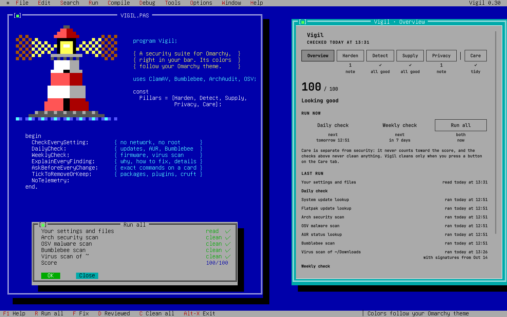

# Vigil - Security Suite



A security suite for [Omarchy](https://omarchy.org): one lighthouse in the bar,
one panel, five pillars.

| Pillar | The question it answers |
|---|---|
| **Harden** | Can someone get in? Firewall, SSH, kernel protections, disk encryption, screen lock, sudo, security keys, updates, open ports. |
| **Detect** | Is something bad already here? Malware hiding places, files that changed, virus scanning through [ClamUI](https://github.com/linx-systems/clamui). |
| **Supply** | Can I trust what I installed? Known-compromised packages through Perplexity's [Bumblebee](https://github.com/perplexityai/bumblebee), known vulnerabilities, AUR packages, your other Omarchy plugins. |
| **Privacy** | What does this machine tell the networks it joins? DNS fallback, hardware address, connectivity pings, announcements, telemetry opt-outs. |
| **Care** | Is the system tidy? Thumbnails, trash, caches, what removed apps left behind, old packages and logs. |

Vigil keeps no threat lists of its own. Everything it checks against comes
from the people who maintain it (the Arch security team, OSV.dev and the
OpenSSF, ClamAV, Perplexity's Bumblebee, the AUR itself), and Vigil
refreshes it by itself, daily or weekly. It is tuned for no false alarms:
only confirmed problems lower the score, and anything that is merely worth
knowing is shown as information.

Every finding says, in plain language, what Vigil found and why it matters.
Most come with a fix. Nothing changes until you press **Run** on a
confirmation in the panel that says exactly what will happen; anything that
needs root then asks for your password, and the panel shows the result.

Vigil is written for people who are new to Linux security. If you are not,
the [security model](docs/SECURITY-MODEL.md) explains how it is built.

> **Status: 0.30.0.** The [roadmap](docs/ROADMAP.md) lists what comes next, and
> [docs/LANDSCAPE.md](docs/LANDSCAPE.md) compares Vigil with the other
> security plugins for Omarchy.

## Install

```sh
omarchy plugin add https://github.com/keasbeexd/omarchy-vigil --enable
```

After updating Vigil, restart the shell so the new panel loads (the panel
offers a **Restart shell** button when it notices the update); until then
the old panel keeps running against the new helper.

The lighthouse appears on the right of the bar. Nothing else is needed: Vigil
uses Python and commands Omarchy already ships. ClamUI, ClamAV, the
scanners and Bumblebee are optional. When any are missing, the Overview shows
a red **MISSING … INSTALL** button before the run buttons; it lists
what it will install, asks once more, and then asks for your password.

## Using it

| | |
|---|---|
| Left-click the lighthouse | Open or close the panel |
| Middle-click the lighthouse | Re-read your settings now (quick, no scans) |
| `←` `→` or `1`–`6` | Switch tabs |
| `↑` `↓`, `Enter` | Move through findings, open one |
| `F` | Fix the selected finding (asks first) |
| `D` | Mark the selected finding as reviewed, or show it again |
| `R` or `S` | Run all (asks first) |
| `U` | Run update check (asks first) |
| `C` | On the Care tab: Clean all |
| `Esc` | Cancel a confirmation, or close |

From a keybinding or script:

```sh
omarchy-shell keasbeexd.vigil toggle
omarchy-shell keasbeexd.vigil refresh
```

The lighthouse is dim until the first check finishes, about eight seconds
after login, and shows its beams while a scan or update runs. It takes your
theme's urgent colour when something needs fixing and its accent colour when
only improvements are left; every colour in Vigil comes from your Omarchy
theme. The **Overview** tab shows your score out of 100, the countdowns to
the next checks, the four run buttons, each pillar with how many findings it
has to fix, to improve, and for information, and the Last run list. In the
pillar tabs, rows with nothing to do (passing, not applicable, or marked as
reviewed) are dimmed.

### When Vigil runs what

Vigil has three schedules. The Overview counts down to the next run of each,
and the Last run list names the schedule of every row.

| What | When |
|---|---|
| **Daily check**: the settings checks, a virus scan of what is new in Downloads, the check for waiting system, Omarchy and Flatpak updates, a Bumblebee scan of your packages | once a day, in the background, at low priority (the settings checks also every 30 minutes and whenever you open the panel) |
| **Weekly check**: the firmware check, then a virus scan of your whole home folder | once a week, in the background, at low priority |
| **Update check**: ClamAV's virus signatures, known vulnerabilities, malicious packages, AUR status, Bumblebee's list | once a week, in the background (without the signatures, which need your password; ClamAV's own update service keeps them current anyway) |
| Password check (accounts without a password) | only when you press **Run all**, since it needs your password |
| Cleaning (Care) | only when you ask; Vigil only measures sizes by itself |

The Overview has a button for each schedule, and one for all of them. Each
asks first, on a card that lists exactly what it runs:

- **Run daily check** runs the daily check now. No password. Pressed, it
  also installs updates for your own Flatpak apps.
- **Run weekly check** runs the weekly check now: the firmware check, then a
  virus scan of your whole home folder (skipping caches, game libraries,
  `node_modules` and `.git` folders, at low priority). It can take a while;
  a notification says when it is done.
- **Run update check** (or `U`) downloads the latest of everything Vigil
  checks against: ClamAV's virus signatures first (Omarchy asks for your
  password, since they live in a system folder), then the lists of known
  security holes, malicious packages, AUR status and Bumblebee's list, and
  updates an older Bumblebee to the version Vigil pins (behind the same
  password prompt). No scan runs.
- **Run all** (`R` or `S`) runs the update check, then the daily check, then
  the weekly check, plus the password check. The two password prompts come
  first, while you are at the screen. The virus scan of your home folder
  includes Downloads, so Run all does not scan Downloads twice.

The panel shows a progress bar with the current step (and, during a virus
scan, how many files are done), and each line of the Last run list updates as
its step finishes. Results stay on a card in the panel until you close it.

While a check runs, **Stop** under the progress bar ends it:
the step it is on stops, what already finished is kept, and the rest is
tried again the next day (or when you press the button again). Stop also
ends a run left going after the shell restarted.

Only one scan or update runs at a time. Pressing a button while one runs
(on another monitor, or one still going after the shell restarted) starts
nothing new: the panel shows "Already running" with that run's progress
instead. Fixes, Clean all and installs show their own progress bar while
they run, so you can close the panel and come back to it.

Above the buttons, three lines count down to the next daily, weekly and
update check, with the time in your computer's timezone when it is today or
tomorrow: each runs a day or a week after the last one, to the minute, or at
Vigil's next background check if it is already due. Each button resets its
own countdown. Turning off `autoUpdate` leaves all three to the buttons.

Below the pillars, **Last run** lists when each scan last ran and when each
list last updated, with the time: scans first, then updates. Each row names
the schedule that runs it (daily check, weekly check, update check), in that
order. The rows in each tab are ordered the same way: settings checks first,
then the rows of the daily, weekly and update checks. Anything that failed
or is out of date is red.

Work done outside Vigil counts too: the virus signatures row includes
ClamAV's own update service and updates made in ClamUI, and the virus scan
row includes scans you ran in ClamUI (marked "by ClamUI"). The vulnerability,
malicious-package and AUR rows can only show Vigil's own updates, since those
tools keep no record when run by hand.

### Every finding

Open any finding and it says, in this order: **Why it matters** (a sentence
or two), **How to fix**, and **Details**. Below that are its buttons:

- **Fix** (named for what it does) when Vigil can do it, or **Learn more** /
  **Show …** when it can't: a guide in your browser (the Arch Wiki, a
  plugin's page) or a read-only command whose output the panel shows.
- **Undo Vigil's change** once Vigil has changed something for it.
- **Mark as reviewed** on anything that is not passing, when you don't want
  that fix: a port you opened on purpose, an unencrypted desktop that never
  leaves home. It stays in its tab, dimmed, no longer lowers the score or
  notifies, and stays reviewed through every later check and scan. **Show
  again** undoes it. Leftover app data is the one exception: you review it
  item by item with **Keep**, so the row has no Mark as reviewed.

For findings that report evidence rather than a setting (open ports, startup
files, file changes, exposed secrets, infected files, known-malicious or
known-compromised packages, vulnerable packages, system-wide preload,
abandoned AUR packages, plugin capabilities), a review covers what was found
at the time. If something new turns up, the finding comes back.

### Undo

Every change Vigil makes in `/etc` can be undone from the finding it fixed
(cleanups and added passphrases are the exceptions; there is nothing to put
back): open it and choose **Undo Vigil's change**. The undo asks for your password
like the fix did, and it deletes the file only if its first line is still Vigil's
marker; a file someone has edited since is left alone. For Avahi, undo puts
back the original file Vigil saved before its first change.

### Settings

Set these on Vigil's entry in `~/.config/omarchy/shell.json`, or in the bar
settings:

| Key | Default | Meaning |
|---|---|---|
| `refreshMinutes` | `30` | How often to check in the background (5 to 1440). |
| `notifyOnNew` | `true` | One desktop notification when a check that was fine starts failing. It only says how many. |
| `autoUpdate` | `true` | Run the daily, weekly and update checks by themselves (see [When Vigil runs what](#when-vigil-runs-what) and [Where the data comes from](#where-the-data-comes-from)). Off means they run only when you press a Run button. |

## What Vigil checks

Each check has a weight from 0 to 3. A failure costs 10 points per weight
point and a warning 2, so a confirmed problem moves the score a lot and an
improvement only a little; checks with weight 0 are information and never
lower it. A warning you mark as reviewed stops counting.

### Harden

| Check | Finding when | Fix |
|---|---|---|
| Firewall | ufw is not installed, switched off, or lets incoming connections in | Turns ufw on (asks for your password) |
| Kernel self-protection | Any of nine kernel switches is off (`kptr_restrict`, `dmesg_restrict`, `ptrace_scope`, unprivileged BPF, the `fs.protected_*` set, `suid_dumpable`) | Writes `/etc/sysctl.d/90-omarchy-vigil.conf` (asks for your password) |
| Network stack | ICMP redirects, source routing, reverse-path filtering, SYN cookies or broadcast pings are set loosely | Same file as above |
| LLMNR | systemd-resolved answers LLMNR, which attackers on shared Wi-Fi abuse | `/etc/systemd/resolved.conf.d/90-omarchy-vigil-llmnr.conf` (asks for your password) |
| SSH server | sshd runs and allows passwords or root login | `/etc/ssh/sshd_config.d/00-omarchy-vigil.conf`, only if you have an authorized key, validated with `sshd -t` (asks for your password) |
| SSH keys | `~/.ssh` or a private key is readable by others, or a key has no passphrase | Makes them private (no root); **Add a passphrase** runs `ssh-keygen -p` for each key without one (in a terminal, since you type the passphrase; no root) |
| GnuPG folder | `~/.gnupg` is readable by others | Makes it private (no root) |
| Automatic screen lock | Stay Awake is on, the lock is off, or it takes over 15 minutes | Turns Stay Awake off; sets `idle.lock` to 300 seconds, Omarchy's default, with Omarchy's own `omarchy-shell-config` helper (no root) |
| Disk encryption | The system disk is not on LUKS | Cannot be added after install; Arch Wiki guide |
| Restart after updates | A newer kernel is installed than the one running | **Restart now** (after a confirmation) |
| Secure Boot | Shown for information only; Vigil does not suggest setting it up, since a mistake can stop the computer starting | |
| Wrong-password lockout | `pam_faillock` is missing or never locks | Arch Wiki guide |
| FireWire | The machine has a FireWire port and its driver can load (information; shown only on machines with the port) | `/etc/modprobe.d/90-omarchy-vigil-firewire.conf` (asks for your password) |
| Passwordless sudo | Omarchy's passwordless sudo is on | `omarchy-sudo-passwordless --disable` (terminal) |
| Docker group | You are in the docker group, which equals root | `omarchy-remove-security-sudoless-docker` (terminal) |
| Security key or fingerprint | sudo takes only a password (information). On a computer with a fingerprint reader (found by Omarchy's own `omarchy-hw-fingerprint`, which only reads `/sys`), it offers fingerprint instead | `omarchy-setup-security-fingerprint` or `omarchy-setup-security-fido2` (terminal); once set up, **Stop using…** runs Omarchy's `omarchy-remove-security-fingerprint` or `-fido2` |
| System updates | A newer Omarchy is out (warning; found by `checkupdates`, the same check Omarchy's own update indicator uses, in each daily check), or no full update in 14 days (warning) or 30 days (failure). Also says how many updates are waiting | `omarchy-update` (terminal) |
| App updates (Flatpak) | Omarchy's updater does not update Flatpak apps. Vigil checks them each day; waiting updates are a warning. **Run daily check** and **Run all** install updates for your own apps without a password | `flatpak update` (no terminal) |
| Open Wi-Fi that joins by itself | Saved networks without a password (or with old WEP) that your laptop joins by itself, so anyone can imitate them. WPA, WPA3 and Enhanced Open never count (warning) | **Stop auto-joining**: `nmcli` sets them to join only when you choose; Undo puts back exactly those |
| Firmware updates | The weekly check asks fwupd, which gets firmware from LVFS where hardware makers publish it. A waiting update that fixes a known security hole (a CVE, or marked high or critical) is a warning; other firmware updates are information | `omarchy-update-firmware` (terminal) |
| Open network ports | Programs listen on the network with no firewall in front | **Show listeners** runs `ss -tulpn` as root and shows the result in the panel (read-only) |
| Exposed secrets | API keys and tokens in the formats their providers publish (AWS, GitHub, GitLab, Slack, Stripe, Anthropic, OpenAI, Google, private keys) in your shell histories, or credential files such as `~/.aws/credentials`, `~/.netrc` and `~/.git-credentials` readable by other accounts. Shows the file and line, never the secret. | Makes credential files private (no root); revoke leaked keys with their provider |

### Detect

| Check | What it does |
|---|---|
| Startup files | Reads shell startup files, autostart entries, user services and timers, uwsm and environment.d files, Hyprland config and your crontab, and flags lines that download and run code, decode hidden code, or open reverse shells. These are leads to read, not proof. |
| System-wide preload | Fails if `/etc/ld.so.preload` loads anything; rootkits use it to hide. |
| Changes to important files | Records a fingerprint of accounts, PAM, SSH settings, `~/.ssh/authorized_keys`, system and user services, autostart entries and your startup files, and lists anything changed, added or removed since. Changes that match exactly what a package update shipped (from pacman's own records) are not reported, nor are system users that packages add. Changes to who can log in or what runs at start are warnings; changes to your own shell files are information. **Accept these changes** records the current state as the new normal. |
| Virus scan | ClamAV scans your home folder in each weekly check, and every day what is new in Downloads, as you, with signatures ClamAV keeps current. Infected files are listed with **Open ClamUI** to quarantine them. If ClamAV is wrong about a file you know is safe (a game's DLL, say), press **False positive** next to it: Vigil records that exact file's SHA-256 and stops counting it, and reports it again if the file ever changes. **Not a false positive** counts it again. Only ClamAV's published signatures count; its guess-based "potentially unwanted" rules stay off. |
| Scans scheduled twice | Finds other apps that repeat what Vigil already runs: a scheduled scan in ClamUI whose folders are all inside your home folder, and the older Bumblebee plugin (once Vigil runs Bumblebee itself). **Let Vigil run them** turns those off the way you would in each app: ClamUI's timer and its own Scheduled scans setting, and `omarchy plugin disable` for the plugin. Undo turns back on exactly what it turned off. A ClamUI schedule that also covers folders outside your home folder (Arch or Flatpak ClamUI: they share one timer, so ClamUI is then left alone entirely), and the Security Scan plugin (it runs AUR-Malware, which Vigil does not), are listed but left on. Nothing is offered when Vigil's background checks are off. |
| ClamUI | Vigil hands virus scanning to [ClamUI](https://github.com/linx-systems/clamui): file and folder scans, scheduled scans, USB drive scans and quarantine. When it is installed, **Open ClamUI** starts it; otherwise Vigil installs it from the Arch repositories (`clamui`), so the Omarchy update keeps it current, and it uses the system's ClamAV. A ClamUI you installed from Flathub keeps working. |
| ClamAV virus engine | Whether ClamAV is installed and its signatures keep themselves up to date. Vigil turns on ClamAV's own update service (`clamav-freshclam`) when it installs ClamAV or ClamUI, and offers to if it is off. |

### Supply

| Check | What it does |
|---|---|
| Known-compromised packages | Runs Perplexity's [Bumblebee](https://github.com/perplexityai/bumblebee) in each daily check. It checks your packages, lockfiles, editor and browser extensions and MCP configs against the compromised releases Perplexity tracks, and reads files only. **Install** downloads Bumblebee 0.1.2, the version this Vigil was reviewed with, installs it only if it matches the SHA-256 written in Vigil's code, and puts it in `/usr/local/bin/bumblebee` (owned by root). Vigil never fetches a newer Bumblebee by itself: a newer version arrives with a Vigil update. When the installed one is older, the row offers **Update Bumblebee**, and **Run update check** installs it behind its one password prompt. |
| Known-malicious npm and Bun packages | Runs [osv-scanner](https://github.com/google/osv-scanner) over your AUR build folders (`~/.cache/yay`, `~/.cache/paru`) and global npm, Bun, mise and pnpm installs, against [OSV.dev](https://osv.dev), which includes the [OpenSSF Malicious Packages](https://github.com/ossf/malicious-packages) reports. This is how the 2026 Atomic Arch AUR attack (which pulled malware in with `bun install`) and the npm worms that run on Bun are caught. Only confirmed malware (`MAL-` entries) counts; ordinary vulnerabilities in development dependencies are left out. |
| Known vulnerabilities | Installs arch-audit, which uses the Arch security team's tracker, and lists only the problems an update fixes. |
| AUR package status | Asks the AUR about your AUR packages: which have left the AUR, which are now in the official repositories, and which have no maintainer (most 2026 AUR attacks took over such orphans). Information only, since packages leave the AUR for ordinary reasons too. |
| AUR and other foreign packages | Lists packages that did not come from the official repositories, so you can remove what you no longer recognise. |
| Other Omarchy plugins | Lists your third-party plugins and what each one's code can do: network access, root through sudo or pkexec, shell commands, downloading and running code, compiled binaries. Vigil reads the files as text and never loads or runs them. |

### Privacy

| Check | Finding when | Fix |
|---|---|---|
| DNS fallback servers | systemd-resolved falls back to Google, Cloudflare or Quad9 | `/etc/systemd/resolved.conf.d/90-omarchy-vigil-fallback.conf` (asks for your password) |
| Connectivity check | NetworkManager pings a server every few minutes (information) | `/etc/NetworkManager/conf.d/90-omarchy-vigil-connectivity.conf` (asks for your password) |
| Hardware address on Wi-Fi | Networks see your real MAC address | `/etc/NetworkManager/conf.d/90-omarchy-vigil-mac.conf` (asks for your password) |
| Network announcements | Avahi announces this machine's name | Sets `disable-publishing=yes` in `/etc/avahi/avahi-daemon.conf` (asks for your password). Refuses unless the setting appears exactly once under `[publish]`, keeps the first original as `avahi-daemon.conf.vigil-backup`, and restores the previous file if Avahi does not restart. |
| Telemetry opt-out variables | `DO_NOT_TRACK` and similar are not set (information) | Writes `~/.config/uwsm/env.d/90-omarchy-vigil-opt-out` (no root) |
| Black Ops | Shows whether [Black Ops](https://github.com/brightwalker25/omarchy-black-ops) is installed; it blocks app telemetry, which Vigil leaves to it | |

### Care

| Row | What it measures | Cleanup |
|---|---|---|
| Thumbnail cache | Previews the file manager made of your pictures and videos | Cleared without root |
| Trash | Files you deleted in the file manager | Emptied without root, directly in its standard folders |
| Application caches | Files apps keep in `~/.cache` to start faster | **Clear unused** (no root), see below |
| Leftover app data | Settings and data that apps you removed left in your home folder | **Move to trash** or **Keep**, one item at a time (no root), see below |
| Package cache | Packages pacman downloaded | `paccache -rk2` and `paccache -ruk0` (asks for your password), see below |
| Orphaned packages | Packages nothing needs any more | `omarchy-update-orphan-pkgs`, which asks before removing anything |
| System logs | The system journal | `journalctl --vacuum-time=2weeks` (asks for your password) |

**Application caches.** A file in `~/.cache` counts as unused when no app
has read or changed it for a week, whether or not that app is open now.
Apps you use every day touch their caches each time they start, so on a
busy computer most of `~/.cache` stays "in use", and closing your apps does
not change that. **Clear unused** appears once more than 1 MB has gone a
week untouched, such as the cache of an app you stopped using. Caches in use
are never deleted, since apps would only rebuild them. To see what takes the
space: `du -sh ~/.cache/* | sort -h`.

**Leftover app data.** When you remove an app, its settings and data stay
in your home folder. A file's age says little here (you set an app up once
and it reads those settings for years), so Vigil asks a different question:
does anything on this computer still use it? A folder counts as used when
its name matches an installed package (or what a package provides), a
program, a desktop entry or its window class, an installed Flatpak,
Omarchy's own configs, a running program, or a line in your startup files
(`~/.bashrc` naming `~/.cargo/bin`, say). Folders whose names do not look
like their app, such as `~/.mozilla` for Firefox or `~/.config/Code` for
VS Code, are matched too. Shared folders no single app owns (`autostart`,
`systemd`, `gtk-3.0`, `fontconfig`, `pipewire`, `hypr`, `omarchy`, ...)
and folders that hold your keys or shell (`~/.ssh`, `~/.gnupg`,
`~/.oh-my-zsh`, `~/.nvm`, ...) are never listed, and neither are links,
which usually come from a dotfile manager.

| Where | Listed when |
|---|---|
| `~/.config`, `~/.local/share`, `~/.local/state`, and the folders in `~` that start with a dot | nothing uses it, and nothing in it has changed for 30 days |
| `~/.var/app` | its Flatpak app is no longer installed (`flatpak uninstall` keeps your data unless you ask) |
| `~/.local/bin` | it is a link to a program that is gone |
| `~/.local/share/applications` | the launcher starts a program that is gone, or a Flatpak that is no longer installed |

The list is information: it never lowers the score or notifies. Open the
row and go through it item by item:

- **Keep** leaves it where it is: settings you want back if you install the
  app again, or something Vigil cannot know you use. It stays in the list,
  dimmed and marked "(kept)", and is no longer counted. **Stop keeping**
  counts it again. Both only change Vigil's own notes, so they do not ask.
- **Move to trash** asks first, then moves it to the trash, the same
  trash your file manager uses. Nothing is deleted: open the trash in your
  file manager and choose **Restore** to put it back. Emptying the trash
  deletes it for good, and so do **Empty** on the Trash row and
  **Clean all**, which empty the trash too.
- **Move all to trash** does the same for every item not kept, after one
  confirmation that lists them.

Just before it moves anything, Vigil looks again: an item that something
now uses, or that you kept, stays where it is. Leftovers are never part of
Clean all.

**Package cache.** Vigil keeps the two newest versions of each installed
package, so a bad update can be rolled back, and frees older versions and
every version of packages you have removed. The row shows how much a dry run
of `paccache` says can be freed; "all of it kept for rollback" means there
is nothing to free.

**Clean all** (or `C` on the Care tab) does every cleanup on offer in one go,
after one confirmation that lists each item and its size: thumbnails, the
trash and unused caches right away, then the package cache and the journal,
for which Omarchy asks for your password once. Orphaned packages are left
out on purpose: removing packages can take away something you use, so that
stays a separate, reviewed step.

### Accounts, history and old services

Checks a newcomer benefits from that need no extra tools:

| Check | Finding when | Fix |
|---|---|---|
| User accounts | Another account has root's powers, accounts share one ID (both from `/etc/passwd`), or an account has no password (from the last Run all, which reads `/etc/shadow` as root after your password and keeps only the account names) | How to fix and the Arch Wiki guide; Vigil does not change accounts itself, since a mistake can lock you out |
| Shell history | A history file (`~/.bash_history`, `~/.zsh_history`, `~/.histfile`, fish) is a link or not a normal file, a way attackers hide what they typed | Guide (MITRE ATT&CK); mark as reviewed if you did it yourself |
| Old network services | A telnet, rsh, rlogin, FTP, TFTP, NIS or xinetd service is switched on | **Switch them off**: `systemctl disable --now` on each one that is on (asks for your password) |

Earlier versions ran Lynis for these. Vigil now does them itself: Lynis
looks for Debian package names that never match on Arch, and most of its
hundreds of other tests are written for servers.

## How actions run

The panel always says which kind an action is:

1. **No fix**: Vigil explains and leaves it to you.
2. **Helper actions** run `bin/vigil fix <action>` as you, never as root:
   making `~/.ssh` and `~/.gnupg` private, the opt-out file, the thumbnail
   cache, the trash and unused application caches. Each is a fixed action name; nothing from a file or
   from the report reaches it.
3. **Script actions** run one of the constant scripts in
   [`Model.js`](Model.js) without a terminal. The panel first shows what it
   will do in plain words, with the exact commands under the **Run** button
   (every step that runs as root in full, as it will run), and waits for
   **Run**. Scripts that need root run through `pkexec`, so Omarchy's own
   password dialog asks; cancelling it changes nothing. The panel then shows
   what the script printed. Only tools that ask you questions as they go
   still open a terminal: Omarchy's updater, its FIDO2 key
   and fingerprint setup, passwordless sudo, the docker group, the orphan review, and
   choosing an SSH passphrase. Packages Vigil installs come straight from
   the Arch repositories with `pacman --needed --noconfirm`; Bumblebee, the
   one exception, comes from Perplexity's release, checked against the
   SHA-256 in Vigil's code.
4. **Open an app or a guide**: **Open ClamUI** starts ClamUI directly, and
   **Learn more** opens a page with `xdg-open`, each with a fixed command and
   no shell. Pages come only from a fixed list in `Model.js` (Arch Wiki,
   MITRE ATT&CK, Perplexity's Bumblebee, Black Ops); nothing in the report becomes a URL.
   They change nothing, so they do not ask first.
5. **Mark as reviewed**, **Show again**, **Not a false positive**, **Keep**
   and **Stop keeping** only change Vigil's own notes, so they do not ask
   first either. **Move to trash** asks first, and moves an item with one
   rename into the trash; it never deletes anything.

Vigil never runs a file from its own folder as root (root only ever runs
`/usr/bin/bash` with one of the fixed scripts, after your password), never
adds a sudoers rule, polkit policy, service or timer, and never changes a
setting on its own.

## What it costs your computer

Vigil runs no service, timer or daemon of its own. While you are logged in:

- **A check every 30 minutes** (the `refreshMinutes` setting), from one
  monitor's copy only, at lowered priority. It reads files only, and every
  folder walk has a time and size limit (a few seconds), so even a huge home
  folder cannot make it slow. Other monitors check only when you open their
  panel.
- **The background checks** (the daily check, and the weekly and update
  checks once a week each) at low priority; the virus scans themselves run
  at the lowest (`nice -n 19`). A background run starts at most once every
  six hours, whatever happens to it, so a run that keeps failing can never
  restart in a loop.
- **One run at a time**, across monitors and shell restarts.
- **Every step has a deadline**: the virus scan of your home folder 3 hours,
  the Downloads scan and Flatpak updates 30 minutes, the other steps
  between 15 seconds and 10 minutes, and the panel stops anything that runs
  past its own backstop. A step that fails is retried the next day; a virus
  scan that runs out of time waits a week instead of repeating hours of
  work every day.
- **Nothing polls** except while a scan started elsewhere is running, when
  the panel asks every 4 seconds for its progress (a file read).

## Where the data comes from

Vigil keeps no threat lists of its own.

| What | Maintained by | How it stays current |
|---|---|---|
| Virus signatures | ClamAV (Cisco Talos) | ClamAV's own `clamav-freshclam` service, several times a day |
| Known vulnerabilities in Arch packages | Arch Linux security team | arch-audit, once a week (and **Run update check**) |
| Known-malicious npm, Bun and other packages | OSV.dev and the OpenSSF Malicious Packages project | osv-scanner, once a week (and **Run update check**) |
| AUR package status | the AUR | AUR lookup, once a week (and **Run update check**) |
| Known-compromised packages, extensions and MCP configs | Perplexity (Bumblebee's `threat_intel` catalogs) | downloaded from Perplexity's repository once a week (and **Run update check**); Bumblebee scans in each daily check |
| Waiting system and Omarchy updates | Arch Linux and Omarchy package repositories | `checkupdates`, once a day (and **Run daily check**) |
| Waiting Flatpak updates | Flathub, or whichever Flatpak remotes you added | `flatpak remote-ls --updates`, once a day (and **Run daily check**) |
| Firmware updates | LVFS (hardware makers publish there) | fwupd, once a week (and **Run weekly check**) |

There is no maintained feed of malicious AUR packages; Arch's own list for
the 2026 attacks was a one-off document. Vigil covers the AUR through what
the malware pulls in (OSV), through ClamAV signatures, and through the AUR's
own package status.

## Privacy

Vigil has no telemetry and no server of its own. Its checks read local files
and ask `systemctl`, `pacman`, `journalctl` and `crontab` about local state.
With `autoUpdate` on (the default), the background checks also contact the
sources they check against, the same way the tools do when you run them by
hand:

- **Daily**: `checkupdates` downloads the package lists from your Arch and
  Omarchy mirrors (into Vigil's own folder, not the system's), and
  `flatpak remote-ls` asks your Flatpak remotes (usually Flathub) which apps
  have updates.
- **Weekly**: `fwupdmgr refresh` downloads firmware information from LVFS
  (fwupd.org).
- **Update check, weekly**: `arch-audit` downloads the Arch security tracker
  from security.archlinux.org; `osv-scanner` sends the names and versions of
  the packages in your AUR build folders and global npm and Bun installs to
  OSV.dev (run by Google), never file contents; Vigil asks
  aur.archlinux.org about your installed AUR packages by name, as yay and
  paru do on every update; and it downloads Bumblebee's lists from
  Perplexity's repository on GitHub.

Each happens only once the tool is installed, and turning `autoUpdate` off
limits it to when you press a Run button. Actions you start yourself also use
the network and say so first: installing a tool (Arch mirrors; Bumblebee
from Perplexity's release on GitHub), ClamAV's signatures (ClamAV's
servers), Flatpak and firmware updates, and `omarchy-update`.

## Files Vigil writes

| Path | Written by | When |
|---|---|---|
| `~/.local/state/omarchy-vigil/state.json` | the helper, mode 0600 | every check: which findings you have already seen, which you marked as reviewed, and one score per day for 30 days |
| `~/.local/state/omarchy-vigil/baseline.json` | the helper, mode 0600 | first check, and when you accept file changes: fingerprints (not contents) of the watched files |
| `~/.local/state/omarchy-vigil/arch-audit.json` | the helper, mode 0600 | in each update check: package names and severities an update fixes |
| `~/.local/state/omarchy-vigil/osv.json` | the helper, mode 0600 | in each update check: known-malicious packages found, if any, and which folders were checked |
| `~/.local/state/omarchy-vigil/aur.json` | the helper, mode 0600 | in each update check: names of AUR packages that left the AUR or have no maintainer |
| `~/.local/state/omarchy-vigil/virus-scan.json` | the helper, mode 0600 | in each weekly check and on Scan now: names of infected files found in your home folder, if any, and how many files were scanned |
| `~/.local/state/omarchy-vigil/no-password.txt` | the helper, mode 0600 | each Run all: names of accounts with an empty password, usually none |
| `~/.local/state/omarchy-vigil/full-scan.json` | the helper, mode 0600 | after each weekly check, automatic or not: its date and time, for the countdown |
| `~/.local/state/omarchy-vigil/bumblebee-catalog.json` | the helper, mode 0600 | in each update check: Perplexity's list of compromised packages, for Bumblebee |
| `~/.local/state/omarchy-vigil/bumblebee-list.json` | the helper, mode 0600 | in each update check: when Bumblebee's list was last downloaded |
| `~/.local/state/omarchy-vigil/signatures.json` | the helper, mode 0600 | when Vigil updates ClamAV's signatures: the date and time |
| `~/.local/state/omarchy-vigil/bumblebee.json` | the helper, mode 0600 | each daily check: the compromised packages Bumblebee found, if any |
| `~/.local/state/omarchy-vigil/progress.json` | the helper, mode 0600 | during a scan or update: its current step, so a panel that did not start it can show it |
| `~/.local/state/omarchy-vigil/run.json` | the helper, mode 0600 | during a scan or update: the process IDs and start times of the run and the program it is running, so **Stop** can end it |
| `~/.local/state/omarchy-vigil/handed-over/` | the Let Vigil run them action, mode 0700 | one empty marker per schedule it turned off, so Undo turns back on exactly those |
| `~/.config/clamui/settings.json` (or ClamUI's Flatpak copy) | the Let Vigil run them action, and its Undo | only `scheduled_scans_enabled`, with everything else in the file kept |
| `~/.local/state/omarchy-vigil/pending-updates.json` | the helper, mode 0600 | each daily check: how many updates are waiting, and the Omarchy version if one is |
| `~/.local/state/omarchy-vigil/firmware.json` | the helper, mode 0600 | each weekly check: device names and firmware versions with an update waiting |
| `~/.local/state/omarchy-vigil/downloads-scan.json`, `downloads-scan.list` | the helper, mode 0600 | each daily check: the new files in Downloads it scanned, and any it found infected |
| `~/.local/state/omarchy-vigil/confirm-scan.list` | the helper, mode 0600 | only while a scan double-checks what it found: the paths of those files, deleted when it is done |
| `~/.local/state/omarchy-vigil/flatpak.json` | the helper, mode 0600 | each daily check: Flatpak apps with updates waiting |
| `~/.local/state/omarchy-vigil/wifi-autojoin-off` | the Stop auto-joining action | the networks it changed, so Undo puts back exactly those |
| `~/.local/state/omarchy-vigil/checkup-db/` | `checkupdates`, as you | each daily check: its private copy of the package databases (a few MB) |
| `~/.local/state/omarchy-vigil/ignored-detections.json` | the helper, mode 0600 | when you mark a virus detection as a false positive: the file's path, the signature name and the file's SHA-256 |
| `~/.local/state/omarchy-vigil/kept-leftovers.json` | the helper, mode 0600 | when you press Keep on a leftover: its id and where it is |
| `~/.local/share/Trash/files/`, `~/.local/share/Trash/info/` | the helper | only when you move a leftover to the trash: the item itself, and a `.trashinfo` file with where it came from, as every file manager writes |
| `~/.local/state/omarchy-vigil/busy/` | the helper, mode 0700, empty | once: the folder Vigil locks so only one scan or update runs at a time |
| `~/.local/state/omarchy-vigil/last-run.json` | the helper, mode 0600 | after each daily or update check: its date, time and whether every source updated |
| `/usr/local/bin/bumblebee` | the Install, Update Bumblebee, Run update check or Run all button, as root | only when you install Bumblebee, or update an older one: Perplexity's program, version 0.1.2, checked against the SHA-256 in Vigil's code |
| `~/.config/uwsm/env.d/90-omarchy-vigil-opt-out` | the helper | only when you set the opt-out variables |
| `/etc/sysctl.d/90-omarchy-vigil.conf` | a script action, as root | only when you apply the kernel settings |
| `/etc/systemd/resolved.conf.d/90-omarchy-vigil-llmnr.conf` | a script action, as root | only when you turn LLMNR off |
| `/etc/systemd/resolved.conf.d/90-omarchy-vigil-fallback.conf` | a script action, as root | only when you remove the DNS fallback |
| `/etc/ssh/sshd_config.d/00-omarchy-vigil.conf` | a script action, as root | only when you harden SSH |
| `/etc/NetworkManager/conf.d/90-omarchy-vigil-connectivity.conf` | a script action, as root | only when you turn the connectivity check off |
| `/etc/NetworkManager/conf.d/90-omarchy-vigil-mac.conf` | a script action, as root | only when you change the hardware address setting |
| `/etc/modprobe.d/90-omarchy-vigil-firewire.conf` | a script action, as root | only when you turn FireWire off |
| `/etc/modprobe.d/90-omarchy-vigil-protocols.conf` | a script action of an earlier Vigil, as root | only if you turned rarely used network protocols off before 0.12; its Undo still removes it |
| `/etc/avahi/avahi-daemon.conf` (first original kept at `avahi-daemon.conf.vigil-backup`) | a script action, as root | only when you stop Avahi announcements |

Every file in `/etc` that Vigil creates starts with the line
`# Written by Vigil (keasbeexd.vigil)`. ClamUI, the scanners and the Omarchy commands Vigil launches keep their own
files; see their documentation.

## Removing

```sh
omarchy plugin remove keasbeexd.vigil
```

This removes the plugin folder. Vigil runs no services, timers or daemons of
its own, and a scan or update that is running when you remove it stops within
seconds, so nothing of Vigil's keeps running. These stay behind until you
remove them:

- `~/.local/state/omarchy-vigil/` (seen findings, score history, the file
  baseline and the cached results of the checks). It holds nothing you need
  without Vigil; delete the folder in your file manager to remove it. If you
  used **Let Vigil run them** and want ClamUI's schedule back, press its
  Undo first, and likewise **Undo** on **Stop auto-joining** if you want
  those Wi-Fi networks to join by themselves again.
- The opt-out file, if you set it. Remove it from the Privacy tab before
  uninstalling, or delete `~/.config/uwsm/env.d/90-omarchy-vigil-opt-out`.
- Settings you applied in `/etc`. They are your system settings now and keep
  protecting you after Vigil is gone. To undo one, delete its file from the
  table above with `sudo rm <file>`, then reboot (or restart the service
  named in the table). For Avahi, restore the original with
  `sudo mv /etc/avahi/avahi-daemon.conf.vigil-backup /etc/avahi/avahi-daemon.conf`.
  Easier: use **Undo** on each finding before you remove Vigil.
- Apps and scanners you installed through Vigil. Remove ClamUI with
  `omarchy pkg drop clamui` (or `flatpak uninstall --user io.github.linx_systems.ClamUI`
  if you installed it from Flathub), and `clamav`,
  `arch-audit` or `osv-scanner` with `omarchy pkg drop <name>` (and `lynis`
  or `rkhunter`, if an earlier Vigil installed them). Remove Bumblebee with
  `sudo rm /usr/local/bin/bumblebee`.
- Services Vigil switched on for you. They belong to their packages and keep
  protecting you without Vigil: ClamAV's update service stops with
  `sudo systemctl disable --now clamav-freshclam.service`, and the firewall,
  if you turned it on here, with `sudo ufw disable`.

## Requirements

- Omarchy with the Quattro shell.
- `/usr/bin/python3` (Omarchy ships it). Standard library only.

## Development

```sh
python3 -m pytest tests -q          # helper checks, fixes, and marketplace rules
node --test tests/*.test.mjs        # Model.js validation and terminal scripts
omarchy plugin validate .
```

The QML cannot be checked outside Omarchy: it imports `qs.Commons` and
`qs.Ui`, which come from the running shell.

## Credits

Vigil is new code, but it stands on the work of the projects it brings
together, all MIT licensed:
[Black Ops](https://github.com/brightwalker25/omarchy-black-ops) (privacy
protections and its research on Omarchy's defaults),
[Security Scan](https://github.com/Percius04/security-scan) (scheduled
scanners and the startup-file heuristics),
[omarchy-bumblebee](https://github.com/duketopceo/omarchy-bumblebee) (the
idea of bringing Perplexity's Bumblebee to Omarchy), [ClamUI](https://github.com/linx-systems/clamui) (virus scanning
and quarantine), and [SysCare](https://github.com/cytracon/omarchy-syscare)
(cleaning). The reasoning about root in
[omarchy-firewall](https://github.com/illegalstudio/omarchy-firewall) shaped
how Vigil asks for it.

Known-compromised packages are found by Perplexity's
[Bumblebee](https://github.com/perplexityai/bumblebee) (Apache 2.0) and its
`threat_intel` catalogs. Vigil does not ship either: **Install** downloads
the version Vigil pins from Perplexity's release on GitHub, and the catalogs
come from Perplexity's repository.

## License

MIT. See [LICENSE](LICENSE).
